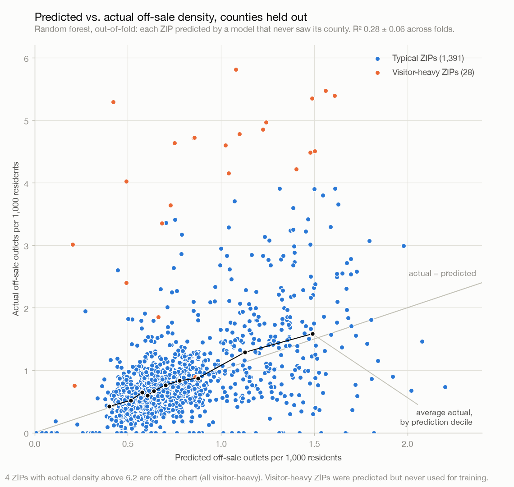
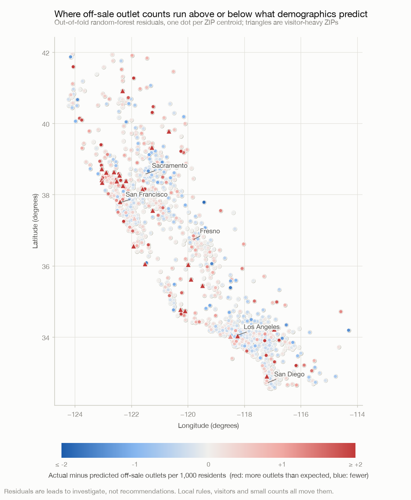

# California Alcohol Retail Market Map

An independent, public-data-only look at California's alcohol retail landscape at ZIP-code level:
70,402 licensed retail outlets (69,249 of them in the 1,419 ZIP codes analyzed), joined to Census
demographics, grouped into market archetypes, and modeled to ask how many off-sale outlets a ZIP's
demographics would predict. It is not affiliated with any company or agency.

## The question

California's Department of Alcoholic Beverage Control (ABC) publishes every licensed outlet. Joined to Census
population, income and age, that data supports three questions:

1. How many outlets of each kind does each ZIP code have? (on-sale: bars and restaurants; off-sale: stores
   selling sealed containers)
2. Which ZIP codes resemble each other? (market "archetypes", found with K-means)
3. How many off-sale outlets would a ZIP's demographics predict, and where does reality differ most?

The project measures market **structure** (who is licensed where), not sales. California does not publish
product-level sales, so this is not a demand or revenue study.

## Headline results

- **Higher-income ZIPs have fewer stores and more bars and restaurants per resident.** From the lowest to the
  highest income fifth, off-sale outlets per 1,000 residents fall from 0.85 to 0.52, and on-sale outlets rise
  from 0.94 to 1.37.
- **Demographics explain about 28% of off-sale density in counties the model has never seen** (R² 0.29 with
  county-held-out cross-validation). A random forest (0.28) does not beat a straight line, and much bigger models
  gain at most 0.02. The rest is visitors, local rules, store format and small-count noise, none of which is in the data.
- **Five market archetypes** emerge, from lower-income low-density areas to affluent suburbs. They are weakly
  separated: a continuum more than distinct groups.
- **The biggest surprises are mostly visitor-heavy places and tiny-count noise, not unmet demand.** Wine-country,
  resort and travel-stop ZIPs run above prediction; tiny ZIPs with no outlets run below.





## Data

| Source | What | Downloaded | Link |
|---|---|---|---|
| California ABC, Daily Data Export | All pending and active license records (129,653 rows) | 2026-10-12 | [ABC licensing reports](https://www.abc.ca.gov/licensing/licensing-reports) |
| US Census Bureau, American Community Survey 5-year, 2024 vintage (2020-2024) | Tables B01003 (population), B19013 (median household income), B01002 (median age), by ZIP Code Tabulation Area | 2026-10-12 | [data.census.gov](https://data.census.gov) |
| Census 2024 ZCTA Gazetteer | Land area and centroid of each ZCTA | 2026-10-17 | [2024_Gaz_zcta_national.zip](https://www2.census.gov/geo/docs/maps-data/data/gazetteer/2024_Gazetteer/2024_Gaz_zcta_national.zip) |
| Census 2020 ZCTA-to-county relationship file | Assigns each ZIP to the county it overlaps most | 2026-10-17 | [tab20_zcta520_county20_natl.txt](https://www2.census.gov/geo/docs/maps-data/data/rel2020/zcta520/tab20_zcta520_county20_natl.txt) |

ABC is the source for all license data and the Census Bureau for all demographic and geographic data. ACS values
are estimates with margins of error.

## Method

1. **Clean.** Load the ABC export untouched, label each license type as on-sale, off-sale or other through a
   lookup table, keep active issued California retail licenses, and deduplicate to one row per outlet and
   channel. Every filter's row count is recorded (129,653 records down to 70,402 outlets).
2. **Join.** Match outlets to Census data on 5-digit ZIP. Mismatches are logged in both directions, ZIPs with no
   outlets are kept as real zeros, and ZIPs under 1,000 residents are set aside.
3. **Cluster.** Standardize six features and run K-means for k = 2 to 10, choosing k = 5 using silhouette
   score, two stability tests and interpretability.
4. **Model.** Predict off-sale outlets per 1,000 residents from log population, log income, median age and log
   density, with four models: training mean, linear regression, random forest, gradient boosting.
5. **Validate.** Five-fold cross-validation that holds out **whole counties**, so every ZIP is predicted by a
   model that never saw its county. Tuning stays inside the training folds, and every ZIP gets an out-of-fold
   prediction and residual.

## Results

**Archetypes** (medians of ZIP values; names are interpretations):

| # | Archetype | ZIPs | People | Median income | Median age | Density per sq mi | Off per 1,000 | On per 1,000 | On share |
|---|---|---|---|---|---|---|---|---|---|
| 1 | Lower-income, low-density, store-heavy | 215 | 2.9M | $67k | 36 | 92 | 1.07 | 0.60 | 33% |
| 2 | Sparse, older towns rich in bars and restaurants | 160 | 1.1M | $80k | 52 | 45 | 1.45 | 2.32 | 63% |
| 3 | Dense, middle-income, few outlets per resident | 370 | 16.6M | $83k | 36 | 5,431 | 0.59 | 0.52 | 45% |
| 4 | Higher-income, dense, bar-and-restaurant scene | 231 | 7.0M | $105k | 39 | 6,243 | 0.79 | 2.38 | 75% |
| 5 | Affluent suburbs, few outlets of either kind | 372 | 11.4M | $137k | 43 | 2,529 | 0.45 | 0.88 | 66% |

**Models** (county-held-out cross-validation, mean of 5 folds, 28 visitor-heavy ZIPs excluded):

| Model | R² | MAE (outlets per 1,000) |
|---|---|---|
| Training mean (baseline) | -0.06 | 0.43 |
| Linear regression | 0.29 +/- 0.04 | 0.35 |
| Random forest | 0.28 +/- 0.06 | 0.35 |
| Gradient boosting | 0.26 +/- 0.07 | 0.35 |

The forest does not clearly beat the linear baseline. Bigger forests, extra-trees and a larger boosting search
reached at best 0.31 (`outputs/tables/model_heavy_results.csv`). Population density and median income carry most of
the signal. All 14 robustness checks pass (population floor, visitor flag, k, feature sets); see
[docs/findings.md](docs/findings.md) for the five findings, each with its caveat and evidence table.

## Figures

All in `outputs/figures/`, each with a table twin in `outputs/tables/`.

| Figure | File |
|---|---|
| Off-sale density distribution | `08_density_distribution.png` |
| Choosing k: inertia, silhouette, stability | `05_k_selection.png` |
| Archetypes in PCA space, axes named in words | `05_pca_clusters.png` |
| Permutation importance | `06_permutation_importance.png` |
| Predicted vs actual (out-of-fold) | `08_predicted_vs_actual.png` |
| Residual map | `08_residual_map.png` |

## Limitations

Licenses are not sales. State quotas and local ordinances shape counts and are not modeled. The file is a snapshot
of current licenses, so closed outlets are absent. Some ABC ZIPs have no Census area (95 ZIPs, 123 outlets).
Residuals in small ZIPs are mostly count noise. Twenty-eight visitor-heavy ZIPs are flagged and kept out of
training: 26 by a documented rule and 2 (Napa city) added by hand after the first model run. Cross-validation holds
out counties but not neighboring ZIPs across county lines. Residuals are leads to investigate, not recommendations
about where outlets should be. Full list in [docs/findings.md](docs/findings.md).

## Ethics and privacy

The raw ABC file contains licensee names and mailing addresses, some of them individuals. It is never committed
(`data/raw/` is git-ignored) and the cleaned tables drop those columns. This repository publishes only ZIP-level
aggregates. Race and ethnicity are deliberately left out of the models: alcohol-outlet siting is a public-health
topic where modeling on racial composition is ethically fraught, so results are kept descriptive.

## How to reproduce

Needs Python 3.13. From a fresh clone:

```bash
git clone https://github.com/saarangarao/ca_alcohol_predictive_map.git
cd ca_alcohol_predictive_map
python -m venv .venv && source .venv/bin/activate
pip install -r requirements.txt
```

Download the raw data into `data/raw/` (it is not in the repository):

| Save as | From |
|---|---|
| `data/raw/abc/ABC-DailyDataExport.csv` | "Daily Data Export" (CSV) on the ABC licensing reports page. It is refreshed weekly, so a newer file gives slightly different numbers. |
| `data/raw/acs/Population.csv`, `Median-Income.csv`, `Median-Age.csv` | data.census.gov: tables B01003, B19013 and B01002, ACS 5-year 2024, geography "ZIP Code Tabulation Area" for California (the files used here hold 1,808 ZCTAs; the code keeps ZIPs 90001 to 96162). Save each table's data file under these names (two header rows: codes, then labels). |
| `data/raw/census_ref/2024_Gaz_zcta_national.txt` | Unzip the Gazetteer file linked above. |
| `data/raw/census_ref/tab20_zcta520_county20_natl.txt` | The relationship file linked above. |

Then:

```bash
python run_all.py          # or: make all
```

This runs the tests, then every step from raw files to figures (about 2 minutes on a laptop) and rewrites
`outputs/tables/` and `outputs/figures/`. `python run_all.py --with-heavy` also runs the bigger-model experiment.

## Repository layout

```
run_all.py  Makefile  requirements.txt  pytest.ini
src/        ingest_abc.py  ingest_acs.py  build_features.py  run_queries.py
            cluster.py  model.py  interpret.py  figures.py  model_heavy.py
queries/    01_*.sql ... 07_*.sql   documented SQL analysis layer, run by src/run_queries.py
tests/      channel mapping, deduplication and ZIP cleaning
data/reference/channel_lookup.csv   license type -> channel (committed)
docs/       data_guide.md (column dictionary)   findings.md (claims, caveats, limitations)
outputs/    tables/  figures/       ZIP-level aggregates only
notebooks/  early exploration scripts
```

## Next steps

Most valuable: a visitor proxy (for example the share of housing vacant for seasonal use, ACS table B25004) and
regulation signals from ABC's license-concentration reports, since those are the largest sources of unexplained
variation. Also: count models with a population offset, a tract-level version with about 9,000 areas, propagating
ACS margins of error, spatial diagnostics, and real ZIP-boundary choropleth maps.
